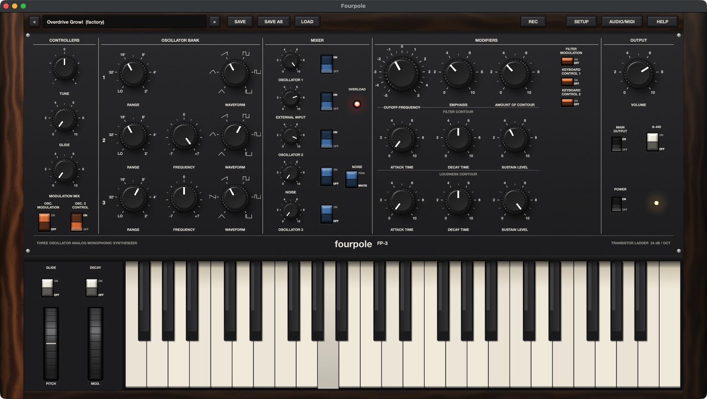

# Fourpole

A desktop three-oscillator monophonic synthesizer built for research. It reproduces the architecture, controls and playing behaviour of the classic 1970 portable monosynth: three VCOs, a mixer, the 24 dB/octave transistor-ladder filter, two contours and a 44-key low-note-priority keyboard. It uses an original name and panel design; it doesn't use any manufacturer's names, logos, artwork or firmware.

C++20 / JUCE 8, macOS (Apple Silicon tested). The DSP core is platform-neutral and unit-tested.



The research behind it, with sources, is in [docs/research.md](docs/research.md).

## Build & run

### Requirements (macOS)

- **Xcode Command Line Tools** (compiler and git): `xcode-select --install`
- **CMake 3.22+ and Ninja**, e.g. with [Homebrew](https://brew.sh): `brew install cmake ninja`

### Build

From the project folder, run these one at a time:

```sh
bash scripts/bootstrap.sh
cmake -S . -B build -G Ninja -DCMAKE_BUILD_TYPE=Release
cmake --build build
open build/Fourpole_artefacts/Release/Fourpole.app
```

- `bootstrap.sh` downloads JUCE 8.0.15 into `external/`. It isn't committed to git.
- The first build compiles JUCE too, so it takes a few minutes.
- To run the DSP tests: `./build/FourpoleTests_artefacts/Release/FourpoleTests`

## Playing it

- **Keyboard:** click the keys (drag for a glissando).
- **Computer keyboard:** `A W S E D F T G Y H U J K O L P ; '` play C up to F. `Z` / `X` move down / up an octave.
- **MIDI controller:** plug it in at any time, before or after starting Fourpole. Notes, pitch bend, the mod wheel and a sustain pedal work, and keys you play over MIDI light up on the screen keyboard. Knobs and buttons can turn the panel's controls (see below).
- **Wheels:** PITCH springs back to the centre; MOD stays where you leave it.
- **Patches:** `<` `>` (or the arrow keys) step through the factory patches, then your own. **Save** / **Save as** write `.fourpole` files (plain JSON) to `~/Music/Fourpole Patches`. **Load** opens one from anywhere.
- **Setup:** conveniences the original didn't have:
  - pitch-wheel range;
  - note priority: low (the original), high or last;
  - velocity to loudness (off on the original);
  - oscillator drift: off, subtle or vintage.
- **Readouts:** hover over a knob (or turn it) to see its value in real units: cutoff in Hz, contour times in ms or s, frequency in semitones, the range in feet, the waveform's name.
- **REC** records what you play to a WAV file in `~/Music/Fourpole Recordings`. The REC lamp lights and the name plate shows the time.
- **POWER** (bottom of the OUTPUT section) switches the instrument off and on, with its pilot lamp.
- **Help** (or `?`): a quick guide.

### MIDI controller knobs

| CC | Default control | On an MPK Mini mk3 |
|---|---|---|
| 70 | Amount of contour | K1 |
| 71 | Emphasis | K2 |
| 72 | Loudness decay | K3 |
| 73 | Loudness attack | K4 |
| 74 | Cutoff frequency | K5 |
| 75 | Filter decay | K6 |
| 76 | Glide | K7 |
| 77 | Oscillator 2 frequency | K8 |
| 7 | Volume | |
| 1 / 64 | Mod wheel / sustain pedal | |

These also line up with the General MIDI sound controllers (71 resonance, 72 release, 73 attack, 74 cutoff, 75 decay), so many controllers' defaults land somewhere sensible.

**MIDI learn:** right-click any knob or switch and choose **MIDI learn**, then move a knob or press a button on your controller. A switch turns on at values of 64 and above. Right-click again to forget an assignment. **Setup > MIDI controller assignments** lists them all and can reset them. Assignments are saved between sessions.

### External input jack

**Setup > External input jack** sets what EXTERNAL INPUT hears:
- **Nothing plugged in** (the default, like the original): it hears the main output, for the feedback overdrive trick.
- **Audio input 1:** it hears the first input of your audio interface, so any sound (a drum loop, a guitar, a voice) goes through the mixer, the ladder filter and the loudness contour. Hold a key or set the loudness sustain to hear it; macOS asks for microphone access the first time.

## The panel

It reads left to right in signal-flow order, like the original:

| Section | Controls | Behaviour |
|---|---|---|
| **Controllers** | TUNE, GLIDE, MODULATION MIX, OSC. MODULATION, OSC. 3 CONTROL | Master tune (±2.5 semitones). Glide is an RC lag on the keyboard voltage, switched by GLIDE by the wheels. The modulation mix blends oscillator 3 (periodic) with noise (random), and the MOD wheel sets how much reaches its destinations. OSC. MODULATION sends it to the pitch of oscillators 1 and 2. OSC. 3 CONTROL off frees oscillator 3 from the keyboard and widens its FREQUENCY knob to about ±3 octaves, as on the hardware. In LO it's then an LFO from about 0.3 Hz to 20 Hz (the knob's readout shows the rate), and a drone in the other ranges. |
| **Oscillator bank** | RANGE, FREQUENCY, WAVEFORM ×3 | **Range:** LO, 32′, 16′, 8′, 4′, 2′ (octaves; LO is sub-audio). **Frequency:** ±7 semitones on oscillators 2 and 3 (oscillator 3: ±3 octaves when it's free-running); oscillator 1 is the reference. **Waveforms:** triangle, tri-saw, saw, square, wide pulse, narrow pulse. Oscillator 3 has a reverse saw instead of the tri-saw. All band-limited (polyBLEP), free-running (no phase reset), with gentle analog drift. |
| **Mixer** | levels and on/off for oscillators 1–3, EXTERNAL INPUT and NOISE (white or pink), OVERLOAD lamp | The mixer saturates softly; past roughly 6 on several sources it drives the filter, and the lamp lights. **EXTERNAL INPUT** has nothing plugged in, so it hears the main output, like the original. Turn it up for the feedback overdrive trick. VOLUME changes how hard it drives: with EXT and VOLUME both up, OVERLOAD lights. |
| **Modifiers** | CUTOFF FREQUENCY (−5…+5, an octave per step), EMPHASIS, AMOUNT OF CONTOUR (0–4 octaves), KEYBOARD CONTROL 1 / 2 (⅓, ⅔, both = full tracking), FILTER MODULATION; filter and loudness contours (ATTACK, DECAY, SUSTAIN) | **Filter:** a nonlinear transistor-ladder model (4 saturating stages in a feedback loop, after Huovilainen, run at 2× oversampling). Emphasis at 10 self-oscillates at the cutoff frequency; with both keyboard-control switches on, the filter plays in tune as a sine oscillator. **Contours:** attack 1 ms–10 s, decay 4 ms–35 s, RC-shaped segments. There's no release knob: **DECAY** by the wheels on = notes release at the decay time, off = almost instantly. |
| **Output** | VOLUME, MAIN OUTPUT on/off, A-440 | A-440 adds a 440 Hz reference tone for tuning other instruments. |

**Keyboard behaviour:**
- 44 keys, F to C.
- **Low-note priority:** the lowest held key plays.
- **Single triggering:** playing legato changes the pitch without restarting the contours. They restart only when all keys have been released first.

## Factory patches

| Patch | What it shows |
|---|---|
| Init | A starting point. |
| Fat Bass | Three detuned oscillators an octave apart. |
| Plucked Funk | A narrow pulse with a short, resonant filter decay. |
| Lead Saw | Two saws, glide, oscillator 3 as a vibrato LFO on the mod wheel. |
| Brass | A slow filter attack. |
| Whistle (Self-Osc) | No oscillators: the filter itself, emphasis 10, full keyboard tracking. |
| Overdrive Growl | The EXTERNAL INPUT output-feedback trick. |
| Sub Wobble | Oscillator 3 LFO on the filter, via the mod wheel. |
| Noise Sweep | Noise through a resonant filter sweep. |
| Trill Lead | Oscillator 3 square LFO on pitch, for trills. |
| Tri-Saw Sweep Bass | The tri-saw waveform with a resonant sweep. |

## Architecture

```
src/core/     platform-neutral DSP (unit-tested, no GUI)
  Patch       the patch in panel units (0-10, -5..+5, footages), JSON, factory patches
  Mapping     panel units -> Hz / seconds / octaves (ranges from docs/research.md)
  Dsp         polyBLEP VCO with drift, nonlinear ladder filter, RC contours, white/pink noise,
              low/high/last-note key assigner with single triggering
  Synth       the voice: VCOs + noise + external input / output feedback -> saturating mixer -> ladder -> VCA;
              sustain pedal, power
  PanelControls  every knob and switch by ID: name, range, the patch field it sets. The UI binds its
              widgets through it, MIDI learn stores its IDs, and the tests walk it.
  MidiMap     controller CC -> panel control assignments (MIDI learn)
src/engine/   Engine: audio + MIDI I/O (hot-plug MIDI inputs), sample-accurate note timing, recording
              (a background writer thread), external audio input
src/ui/       panel: Materials (lit renderer for knobs, rockers, lamps, walnut), controls,
              44-key keyboard, MainComponent (layout, patches)
tests/        JUCE UnitTest suites for all of core/
```

**Real-time rules:**
- The audio thread doesn't allocate.
- Patches reach it under a short SpinLock, once per block when they change.
- Notes and controllers from the screen and from MIDI are merged and placed sample-accurately within each block.

**What the tests check (4,019 checks):**
- **Every panel control, one by one** (tests/ControlTests.cpp): each knob, selector and switch is played at different settings and its effect measured. That covers pitch for TUNE, RANGE and FREQUENCY, all six waveshapes on each oscillator (duty cycles, the reverse saw), and levels for the mixer and output. It covers brightness for CUTOFF and pink noise, the resonant peak and self-oscillation for EMPHASIS, and cutoff sweeps for contour amount, keyboard control and filter modulation. It covers every contour knob against its time or level, and the wheels and Setup options. The suite fails if a control in the panel table has no test.
- Every waveform hits its frequency; pulse waves have no DC.
- The ladder rolls off at 24 dB/octave (−73 dB three octaves above cutoff) and self-oscillates within 8% of the cutoff at full emphasis.
- Contour times and the DECAY switch.
- Low / high / last priority and single triggering.
- Glide time constants; keyboard tracking ⅓, ⅔ and full; 4 octaves of contour sweep.
- OSC. 3 CONTROL, vibrato, mixer overload, external-input feedback, A-440.
- The sustain pedal, external audio through the filter, the POWER switch, and the MIDI CC map (learn, defaults, save / load).
- Every factory patch round-trips through JSON and plays.

**Self-test of the real widgets:** `FOURPOLE_SELFTEST=/tmp/report.txt ./build/Fourpole_artefacts/Release/Fourpole.app/Contents/MacOS/Fourpole` launches the app, works every widget and writes a report, then quits. Each widget is turned through its own callbacks, and the test checks that the engine's patch changed that control's field and nothing else. It also checks MIDI learn for all 41 controls and loads every factory patch with < and >, checking each widget shows it. Then it checks by meter that VOLUME, MAIN OUTPUT, POWER and A-440 reach the audio, and that REC writes a file, which it deletes afterwards. Nothing is saved to your settings.

**Testing aid:** `FOURPOLE_CAPTURE_WAV=/path/out.wav open Fourpole.app` records the first 20 s of the app's output to a WAV when it quits. That's how the running app was checked: notes from the screen keyboard and from a MIDI controller plugged in after launch both came out at the right pitch.

## Not done yet

- Nobody has listened to it against a real instrument yet. The voice follows published measurements and circuit models, but the exact tone, filter curve and contour shapes haven't been compared with recordings of the hardware.
- MIDI out (sending the keyboard and knobs to other gear).
- The audio-input setting for EXTERNAL INPUT is unit-tested but hasn't been tried with a real interface in the running app.
- Oscillator hard sync and other later-model additions; polyphony and paraphony (it's a monosynth by design).
- A plugin (AU/VST3) version.
